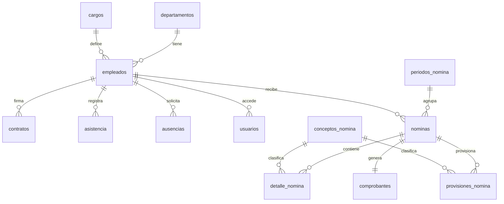

# Sistema de Nómina y Recursos Humanos

Sistema de nómina y recursos humanos con base de datos en **MariaDB** y una aplicación de consola en **Python**. Gestiona empleados, contratos, asistencia y ausencias, y calcula la nómina con devengos, deducciones, prestaciones sociales, aportes del empleador y comprobantes de pago.

Proyecto con fines académicos. Todo el cálculo vive en la base de datos (procedimiento almacenado, vistas y triggers); Python solo lo invoca y presenta los resultados, por lo que cualquier otra aplicación puede reutilizar la misma lógica.

## Contenido

- [Características](#características)
- [Tecnologías](#tecnologías)
- [Estructura del repositorio](#estructura-del-repositorio)
- [Instalación](#instalación)
- [Aplicación en Python](#aplicación-en-python)
- [Modelo de datos](#modelo-de-datos)
- [Cálculo de la nómina](#cálculo-de-la-nómina)
- [Seguridad y roles](#seguridad-y-roles)
- [Scripts académicos](#scripts-académicos)
- [Solución de problemas](#solución-de-problemas)
- [Limitaciones y mejoras futuras](#limitaciones-y-mejoras-futuras)

## Características

**Base de datos**
- Departamentos, cargos, empleados y contratos, con historial de cambios salariales.
- Asistencia con horas extra y ausencias (vacaciones, permisos, incapacidades, licencias) con flujo de aprobación.
- Cálculo de nómina por periodo con `sp_generar_nomina`:
  - Devengos: salario proporcional, horas extra y auxilio de transporte.
  - Deducciones del empleado: salud, pensión e impuesto.
  - Prestaciones sociales: cesantías, intereses sobre cesantías, prima de servicios y vacaciones.
  - Aportes del empleador: salud, pensión, riesgos laborales y caja de compensación.
- Comprobantes de pago con numeración estable (`CP-AAAAMM-ID`).
- Parámetros y porcentajes editables en tablas, sin tocar el código.
- Auditoría automática mediante triggers y roles de seguridad.

**Aplicación en Python**
- Menú de consola con 12 opciones.
- Alta de departamentos, cargos y empleados con validaciones (por ejemplo, el salario debe estar dentro del rango del cargo).
- Registro de asistencia, solicitud y aprobación de ausencias.
- Cálculo de nómina, resumen por departamento y costo laboral.
- Comprobante de pago en texto y exportación a CSV compatible con Excel.
- Consultas con parámetros (protección contra inyección SQL) y transacciones con COMMIT y ROLLBACK.

## Tecnologías

| Componente | Versión recomendada |
|---|---|
| MariaDB | 10.4 o superior (incluida en XAMPP) |
| XAMPP | Apache, MariaDB y phpMyAdmin |
| Python | 3.8 o superior (se recomienda 3.10+) |
| PyMySQL | 1.1 o superior |
| Editor | Visual Studio Code |

## Estructura del repositorio

```
nomina-rrhh/
├─ nomina_rrhh.sql              # Estructura: base de datos, tablas, triggers, procedimiento, vistas y seguridad
├─ insert_sistema_nomina.sql    # Datos iniciales y de prueba
├─ python_app/                  # Aplicación de consola
│  ├─ main.py                   # Menú principal
│  ├─ services.py               # Operaciones: empleados, asistencia, ausencias y nómina
│  ├─ reportes.py               # Tablas, comprobante en texto y exportación a CSV
│  ├─ db.py                     # Conexión, transacciones y consultas con parámetros
│  ├─ config.py                 # Datos de conexión
│  ├─ test_conexion.py          # Prueba de conexión e instalación
│  ├─ requirements.txt
│  └─ README_python.md
├─ scripts_academicos/          # Scripts por categoría SQL para estudiar la estructura
│  ├─ 00_ejecutar_todo.sql
│  ├─ 01_crear_base_datos.sql
│  ├─ 02_datos_ficticios.sql
│  ├─ 03_ddl.sql
│  ├─ 04_dml.sql
│  ├─ 05_dql.sql
│  ├─ 06_vdl.sql
│  ├─ 07_dcl.sql
│  └─ 08_tcl.sql
└─ README.md
```

## Instalación

### 1. Base de datos

1. Abre el panel de XAMPP e inicia **Apache** y **MySQL** (en XAMPP, MySQL es MariaDB).
2. Entra a `http://localhost/phpmyadmin` como `root`.
3. Sin seleccionar ninguna base, ve a **Importar** y sube `nomina_rrhh.sql`.
4. Selecciona la base `nomina_rrhh`, ve a **Importar** y sube `insert_sistema_nomina.sql`.

> **Advertencia:** `nomina_rrhh.sql` elimina y vuelve a crear la base `nomina_rrhh`. Si lo importas de nuevo, debes volver a importar también `insert_sistema_nomina.sql`.

También puedes usar la línea de comandos:

```bash
C:\xampp\mysql\bin\mysql -u root < nomina_rrhh.sql
C:\xampp\mysql\bin\mysql -u root < insert_sistema_nomina.sql
```

### 2. Aplicación en Python

```bash
cd python_app
python -m venv venv
venv\Scripts\activate          # Windows
# source venv/bin/activate     # Linux / macOS
pip install -r requirements.txt
python test_conexion.py
python main.py
```

`test_conexion.py` debe mostrar la versión del servidor, 16 tablas, 8 vistas y los conteos de departamentos, cargos, periodos y empleados. Si alguno aparece como vacío, falta importar los datos.

### 3. Conexión a la base de datos

Valores por defecto de `python_app/config.py`:

| Dato | Valor |
|---|---|
| host | `127.0.0.1` |
| port | `3306` |
| base de datos | `nomina_rrhh` |
| usuario | `rrhh_nomina` |
| contraseña | `Rrhh#2026` (de demostración) |

Para usar otro usuario sin editar el código, por ejemplo `root` en XAMPP (que viene sin contraseña), define variables de entorno antes de ejecutar. En PowerShell:

```powershell
$env:NOMINA_DB_USER = "root"
$env:NOMINA_DB_PASSWORD = ""
python main.py
```

Variables disponibles: `NOMINA_DB_HOST`, `NOMINA_DB_PORT`, `NOMINA_DB_NAME`, `NOMINA_DB_USER` y `NOMINA_DB_PASSWORD`.

## Aplicación en Python

### Menú

| Opción | Qué hace | Usa en la base de datos |
|---|---|---|
| Ver empleados activos | Lista empleados con cargo, departamento y salario | Vista `v_empleados_activos` |
| Gestionar departamentos | Lista y crea departamentos | Tabla `departamentos` |
| Gestionar cargos | Lista y crea cargos con su rango salarial | Tabla `cargos` |
| Registrar empleado y contrato | Crea empleado y contrato en una sola transacción | Tablas `empleados` y `contratos` |
| Registrar asistencia y horas extra | Guarda el registro diario | Tabla `asistencia` |
| Solicitar ausencia | Crea una solicitud pendiente | Tabla `ausencias` |
| Aprobar o rechazar ausencias | Resuelve solicitudes pendientes | Vista `v_ausencias_pendientes` |
| Calcular nómina de un periodo | Genera nóminas, prestaciones, aportes y comprobantes | Procedimiento `sp_generar_nomina` |
| Resumen de nómina por departamento | Totales de devengado, deducciones y neto | Vista `v_resumen_nomina` |
| Costo laboral para la empresa | Devengado más aportes y prestaciones | Vista `v_costo_laboral` |
| Ver comprobante de pago | Comprobante imprimible por empleado y periodo | Vista `v_comprobante` |
| Exportar comprobante a CSV | Guarda el comprobante en un archivo | Vista `v_comprobante` |

### Flujo de uso recomendado

1. Crea los departamentos y cargos que falten (o importa los datos de prueba).
2. Registra empleados, asistencia y ausencias.
3. Calcula la nómina del periodo.
4. Consulta el resumen, el costo laboral y los comprobantes.

### Ejemplo de comprobante

```
========================================================
        Empresa Ficticia S.A.S.  NIT 900000000-1
      COMPROBANTE DE PAGO CP-202609-0003 [EMITIDO]
========================================================
Empleado : Marta Ruiz (doc. 1003)
Cargo    : Asesor comercial - Ventas
Periodo  : 2026-09-01 a 2026-09-30   Días pagados: 28
...
Total devengado                               1,555.63
Total deducciones                               113.26
NETO A PAGAR                                  1,442.37
========================================================
```

### Arquitectura de la aplicación

La aplicación está en capas: `main.py` (interacción con el usuario), `services.py` (operaciones del sistema), `reportes.py` (presentación) y `db.py` (conexión y transacciones). Ninguna fórmula de nómina está en Python.

## Modelo de datos



Tablas independientes: `parametros`, `empresa` y `auditoria`.

| Tabla | Descripción |
|---|---|
| `departamentos`, `cargos` | Catálogos de la organización; cada cargo tiene un rango salarial. |
| `empleados` | Datos personales y laborales. Se usa baja lógica (`activo`). |
| `contratos` | Historial de contratos y salarios. El vigente tiene `fecha_fin` nula. |
| `asistencia` | Entradas, salidas y horas extra por día. |
| `ausencias` | Vacaciones, permisos e incapacidades con estado y marca de pago. |
| `parametros` | Valores editables: recargos, auxilio, salario mínimo, días base de prestaciones. |
| `conceptos_nomina` | Catálogo de devengos, deducciones, provisiones y aportes del empleador. |
| `periodos_nomina` | Periodos con estado: abierto, calculado o cerrado. |
| `nominas` | Una fila por empleado y periodo con totales y neto. |
| `detalle_nomina` | Valor de cada devengo y deducción, guardado como historial. |
| `provisiones_nomina` | Prestaciones sociales y aportes del empleador. |
| `comprobantes` | Comprobante de pago con número, fechas y estado. |
| `usuarios`, `auditoria` | Usuarios de la aplicación y bitácora de cambios. |

Vistas: `v_empleados_activos`, `v_desprendible`, `v_comprobante`, `v_resumen_nomina`, `v_prestaciones`, `v_costo_laboral`, `v_ausencias_pendientes` y `v_horas_extra_mes`.

## Cálculo de la nómina

El procedimiento `sp_generar_nomina(periodo)` es repetible: recalcula el periodo completo mientras no esté cerrado, dentro de una transacción.

| Concepto | Fórmula |
|---|---|
| Días pagados | Días del contrato dentro del periodo (máximo 30) menos las ausencias aprobadas sin pago |
| Salario proporcional | `salario / 30 * días pagados` |
| Horas extra | `horas * (salario / 30 / 8) * (1 + recargo / 100)` |
| Auxilio de transporte | `auxilio / 30 * días pagados`, solo si el salario no supera el tope |
| Deducción | `MAX(0, base salarial - base exenta) * porcentaje / 100` |
| Neto | `devengado - deducciones` |
| Cesantías, prima, vacaciones | `base * días pagados * (días de la prestación al año / 30) / días base del año` |
| Intereses sobre cesantías | `cesantías * días pagados * (porcentaje anual / 100) / días base del año` |
| Aportes del empleador | `base salarial * porcentaje / 100` |

La base salarial es el devengado sin el auxilio de transporte. Las prestaciones son una **provisión mensual**, no una liquidación final de contrato.

Cambiar una regla sin tocar el código:

```sql
UPDATE parametros SET valor = 35 WHERE clave = 'RECARGO_HORA_EXTRA';
CALL sp_generar_nomina(2);
```

## Seguridad y roles

`nomina_rrhh.sql` crea tres roles y un usuario de ejemplo para cada uno:

| Rol | Usuario | Permisos |
|---|---|---|
| `rol_admin` | `admin_nomina` | Todos los privilegios sobre la base de datos |
| `rol_rrhh` | `rrhh_nomina` | Gestiona empleados, contratos, asistencia y ausencias; consulta nómina y ejecuta el cálculo |
| `rol_empleado` | `empleado_nomina` | Consulta de desprendible y comprobante |

> **Importante:** las contraseñas incluidas en los scripts son de demostración. Cámbialas antes de usar el sistema fuera de un entorno de pruebas.

Notas sobre permisos desde Python:
- `rrhh_nomina` solo puede **leer** departamentos y cargos. Para crearlos desde el menú usa `root` o `admin_nomina`, o concede el permiso una vez como administrador:
  ```sql
  GRANT INSERT ON nomina_rrhh.departamentos TO rol_rrhh;
  GRANT INSERT ON nomina_rrhh.cargos TO rol_rrhh;
  ```
- `rrhh_nomina` no puede cerrar periodos ni modificar parámetros.
- El rol de empleado ve la vista completa; una interfaz de producción debe filtrar por el documento del usuario conectado.

## Scripts académicos

La carpeta `scripts_academicos/` separa el mismo sistema por categoría de comandos SQL, para estudiar la estructura:

| Script | Categoría | Contenido |
|---|---|---|
| `01_crear_base_datos.sql` | Creación | Crea la base de datos |
| `02_datos_ficticios.sql` | Datos | Llena las tablas con datos de prueba |
| `03_ddl.sql` | DDL | Tablas, índices, triggers y procedimiento |
| `04_dml.sql` | DML | INSERT, UPDATE, DELETE y cálculo de nómina |
| `05_dql.sql` | DQL | Consultas SELECT para reportes |
| `06_vdl.sql` | VDL | Definición de vistas |
| `07_dcl.sql` | DCL | Roles, usuarios, GRANT y REVOKE |
| `08_tcl.sql` | TCL | Transacciones, COMMIT, ROLLBACK y SAVEPOINT |

El orden de ejecución es **01, 03, 02, 06, 04, 05, 07, 08**, porque las tablas deben existir antes de llenarse. Desde la consola de MariaDB, `00_ejecutar_todo.sql` los ejecuta en ese orden con `SOURCE`.

## Solución de problemas

| Mensaje o síntoma | Causa probable | Solución |
|---|---|---|
| `ModuleNotFoundError: No module named 'pymysql'` | La librería no está instalada en el Python que ejecuta el programa | `python -m pip install PyMySQL`, con el entorno virtual activado si lo usas |
| `Access denied for user 'rrhh_nomina'` | El usuario no existe o la contraseña no coincide | Usa `root` con contraseña vacía, o revisa que se haya ejecutado la sección de seguridad de `nomina_rrhh.sql` |
| `Can't connect to MySQL server` | MySQL no está iniciado o el puerto es otro | Inicia MySQL en XAMPP y confirma el puerto (normalmente 3306) |
| `Unknown database 'nomina_rrhh'` | No se importó `nomina_rrhh.sql` | Importa el archivo desde phpMyAdmin |
| Las listas de departamentos, cargos o periodos salen vacías | Faltan los datos iniciales | Importa `insert_sistema_nomina.sql` o crea los registros desde el menú |
| Error de permiso al crear departamentos o cargos | `rrhh_nomina` solo tiene lectura | Usa `root` o `admin_nomina`, o concede el `GRANT INSERT` indicado arriba |
| No aparece ningún comprobante | La nómina del periodo aún no se calculó | Usa la opción «Calcular nómina de un periodo» |

## Limitaciones y mejoras futuras

- Los valores monetarios (salario mínimo, auxilio de transporte) son **ficticios**, en la escala de los datos de prueba.
- Los porcentajes de aportes y prestaciones siguen un esquema general y son editables. Si tu proyecto debe cumplir una norma laboral específica, verifica y ajusta `parametros` y `conceptos_nomina`.
- Las prestaciones son una provisión mensual, no una liquidación final de contrato, y no promedian las horas extra dentro de su base.
- La aplicación Python no crea periodos de nómina; se cargan con los datos iniciales o directamente en la base.
- Los scripts están pensados para una base recién creada: repetir solo una parte sobre datos existentes puede producir errores de claves duplicadas.
- Un periodo en estado `CERRADO` no se puede recalcular.

Ideas para crecer: interfaz web con Flask, interfaz de escritorio con Tkinter, comprobante en PDF, creación de periodos desde la aplicación, liquidación final de contrato y análisis de la nómina con pandas.

## Autor

Nombre del autor: _completar_

## Licencia

Proyecto con fines académicos. Define aquí la licencia que prefieras, por ejemplo MIT.
